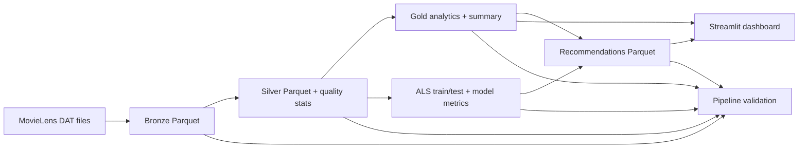

# MovieLens Recommendation Studio

MovieLens 1M analytics and recommendation project using PySpark, Parquet, MLlib ALS, Streamlit, and optional Apache Airflow orchestration.

## Project overview

The project addresses the cold-start and discovery problem in a movie catalog: turn raw user/movie/rating records into trustworthy analytics and personalized recommendations that can be demonstrated locally on an 8 GB Windows laptop. Ratings are trained with collaborative filtering; unknown or low-history users receive an explicit popularity fallback based on observed ratings.

The source dataset is [MovieLens 1M](https://grouplens.org/datasets/movielens/), stored locally under `data/raw/ml-1m/` as Latin-1, `::`-separated `ratings.dat`, `movies.dat`, and `users.dat` files. The processed dataset contains 6,040 users, 3,883 movies, and 1,000,209 ratings from April 2000 through February 2003.

## Key features

- Explicit-schema Bronze ingestion with Latin-1 handling and metadata.
- Silver validation, deduplication, timestamp conversion, genre arrays, and orphan removal.
- Gold movie, genre, demographic, temporal, distribution, and activity analytics.
- ALS collaborative filtering with reproducible held-out RMSE/MAE evaluation.
- Spark-native Precision@K/Recall@K evaluation for future ranking runs.
- Personalized ALS recommendations with rated-item exclusion and popularity fallback.
- Streamlit dashboard with artifact-backed analytics, model, quality, and catalog views.
- Manual-first Airflow orchestration with output invariant validation.

## Technology stack

Python 3.10/3.11, PySpark 3.5.x, Spark SQL/DataFrames, MLlib ALS, Parquet, PyYAML, pandas/pyarrow for small dashboard tables only, Streamlit, Plotly, pytest, Git, and optional Apache Airflow in WSL2 or Docker.

## Architecture

The pipeline is intentionally staged and reuses the functions in `src/recsys`:

```text
MovieLens DAT files
  -> ingest_bronze
  -> clean_silver
  -> build_gold_analytics
  -> train_als_model
  -> generate_recommendations
  -> validate_pipeline_outputs
```



Bronze, Silver, Gold, model, and recommendation artifacts are written below `data/` using the relative paths in `config/config.yaml`. The dashboard reads these existing outputs and does not fabricate missing data.

## Windows prerequisites

- Python 3.10 or 3.11
- Java 11 or 17 for the supported PySpark setup
- PySpark 3.5.x
- On Windows, configure `HADOOP_HOME` and a compatible `winutils.exe` only if Spark requires it.
- Native Apache Airflow installation is not supported on Windows. Use WSL2 or Docker for Airflow. Keep Airflow dependencies separate from the dashboard/PySpark environment.

Install the main environment with:

```powershell
python -m pip install -r requirements.txt
```

## Run without Airflow

From the project root:

```powershell
$env:PYTHONPATH = "$PWD\src"
python -m recsys.pipeline all
```

Individual stages are also available:

```powershell
python -m recsys.pipeline ingest_bronze
python -m recsys.pipeline clean_silver
python -m recsys.pipeline build_gold_analytics
python -m recsys.pipeline train_als_model
python -m recsys.pipeline generate_recommendations
```

The full pipeline can be resource-intensive on an 8 GB laptop, especially ALS training and batch recommendations.

The current real-data ALS run used an 80/20 reproducible split: 800,002 training rows and 200,207 test rows, with 200,160 valid held-out predictions evaluated. Its actual RMSE is `0.869412` and MAE is `0.696190`. A Spark held-out ranking evaluator is available for future runs and reports Precision@K and Recall@K; rating prediction error alone is not ranking quality.

See [docs/model_evaluation.md](docs/model_evaluation.md) for the evaluation protocol and interpretation.

## Airflow

The DAG is `airflow/dags/movie_recsys_dag.py`, with DAG ID `movielens_recommendation_pipeline`. It is manual-first (`schedule=None`) and does not execute when imported.

Airflow dependencies are isolated in `airflow/requirements.txt`:

```bash
pip install -r airflow/requirements.txt
```

Install and run that file in WSL2 or a Docker-based Airflow environment, not the native Windows Python environment. Mount the project directory into the Airflow container/WSL environment and make sure Java, PySpark, and the project dependencies are available there. Then copy or mount the DAG into the Airflow DAGs directory.

Initialize and start Airflow in WSL2:

```bash
airflow db migrate
airflow users create --username admin --firstname Admin --lastname User --role Admin --email admin@example.com
airflow webserver --port 8080
```

In a second shell:

```bash
airflow scheduler
```

Trigger the manual DAG from the UI or CLI:

```bash
airflow dags trigger movielens_recommendation_pipeline
```

Inspect task logs in the Airflow UI, or with:

```bash
airflow tasks test movielens_recommendation_pipeline validate_pipeline_outputs 2026-10-15
```

Airflow was not installed or executed in the Windows development environment for this project. The DAG has static dependency tests and the output validator has local Spark fixture tests.

## Dashboard

Start Streamlit from the project root:

```powershell
python -m streamlit run dashboard\app.py --server.port 8502
```

Open `http://localhost:8502`. The six pages read actual Gold, model, recommendation, ingestion, and quality artifacts. Missing artifacts are reported with a message explaining which pipeline stage must be run.

## Screenshots

Screenshots are intentionally not fabricated or committed with generated data. Capture these files from the running dashboard for a portfolio presentation:

- `docs/screenshots/overview.png`
- `docs/screenshots/movie-analytics.png`
- `docs/screenshots/recommendations.png`
- `docs/screenshots/movie-explorer.png`
- `docs/screenshots/model-performance.png`
- `docs/screenshots/pipeline-quality.png`

The screenshot directory is currently missing; this is a release-preparation TODO rather than an invented result.

## Tests

```powershell
pytest tests -v --basetemp C:\dev\tmp\pt
```

The test suite uses tiny Spark fixtures and does not retrain the real ALS model. The Airflow runtime import test is skipped when the optional Airflow package is unavailable.

## Known limitations and future improvements

- Airflow has not been executed end-to-end on this Windows machine; use WSL2 or Docker for scheduler and worker validation.
- The current saved real-data metrics predate the optional ranking-metric addition; run `train_als_model` to generate ranking metrics for a new model run.
- ALS is collaborative filtering, so brand-new movies without ratings are retained in metadata but are not selected by the popularity fallback.
- Future work can add a ranking-aware train/test evaluation report, model/version metadata, incremental ingestion, and deployment packaging.

Interview-oriented documentation is available in [docs/architecture.md](docs/architecture.md), [docs/model_evaluation.md](docs/model_evaluation.md), and [docs/project_demo.md](docs/project_demo.md).