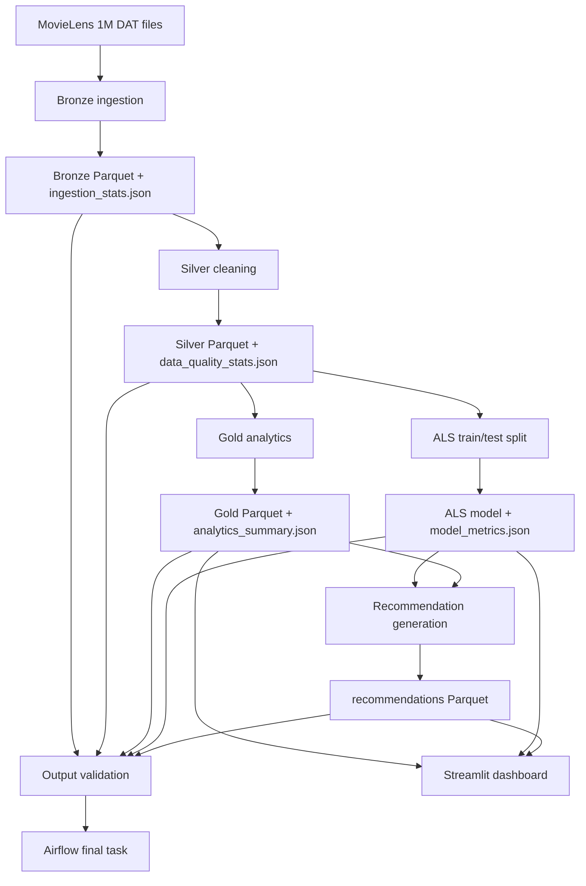

# MovieLens Studio Architecture

## Project shape

MovieLens Studio separates raw ingestion, quality-preserving transformations, analytics, model training, recommendation generation, and presentation. Each stage writes a durable artifact so it can be inspected independently and rerun without hiding failures.

## Execution order

1. `ingest_bronze` reads Latin-1 `::`-separated files with explicit string schemas, adds source metadata, and writes Bronze Parquet.
2. `clean_silver` casts fields, validates IDs, ratings, and timestamps, removes duplicates and orphan ratings, and enriches movies with years and genre arrays.
3. `build_gold_analytics` produces analytics tables and a summary from Silver DataFrames.
4. `train_als_model` uses a reproducible 80/20 split and saves MLlib ALS artifacts and held-out metrics.
5. `generate_recommendations` excludes known interactions, joins movie metadata, and uses observed popularity for unknown or low-history users.
6. `validate_pipeline_outputs` checks artifacts, counts, movie metadata coverage, density/sparsity, and finite model metrics.

## Ownership and paths

Configuration is loaded from `config/config.yaml`; all paths are relative to the project root. The source modules under `src/recsys/` own pipeline behavior. Airflow only calls those functions through `pipeline.py`, so orchestration does not duplicate transformations.

The dashboard reads small Gold/model/recommendation artifacts. It does not convert the million-row ratings table to pandas.

## Interview talking points

- Why Parquet layers? They make stage outputs typed, inspectable, and reusable.
- Why validate at the end? A successful task is not enough; counts and artifact readability are checked explicitly.
- Why a fallback? ALS cannot infer a personalized latent profile for a new user, so the system exposes a transparent popularity strategy instead of inventing scores.